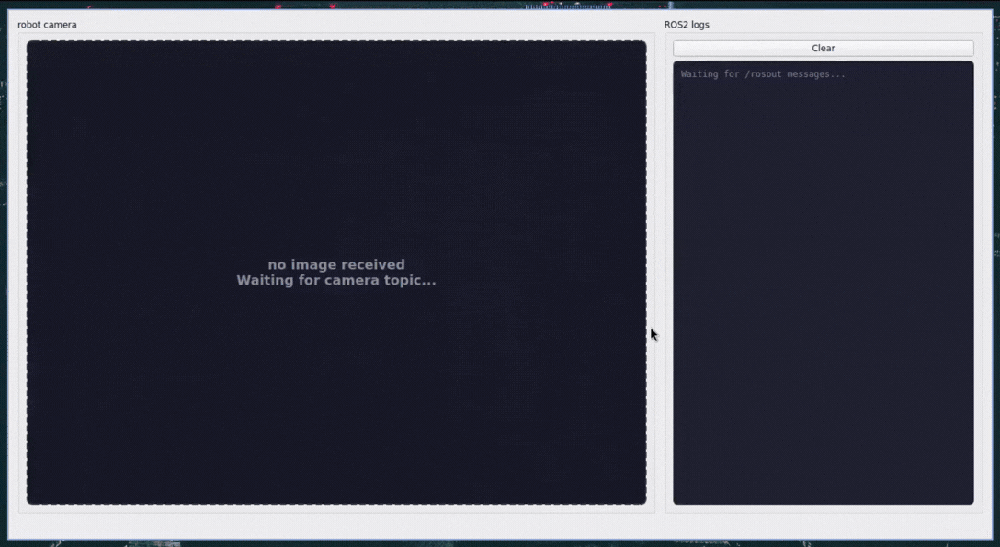

# wayfinder robot

A small ROS2 Jazzy learning project that puts together simulation, nav2 navigation, and ArUco checkpoint detection.

The robot is using a simple differential-drive platform. It drives to a list of checkpoints defined in a YAML file. At each checkpoint it tries to detect an ArUco marker. Everything runs inside Gazebo with a small Qt GUI that shows the robot camera and ROS2 logs from mission_node.


## Demo




## Quick start

```bash
git clone https://github.com/kubaj510/wayfinder_robot.git
cd wayfinder_robot
xhost +local:docker
docker compose up --build
docker compose exec wayfinder_robot bash
colcon build --symlink-install
source install/setup.bash
ros2 launch wayfinder_bringup minimal.launch.py
